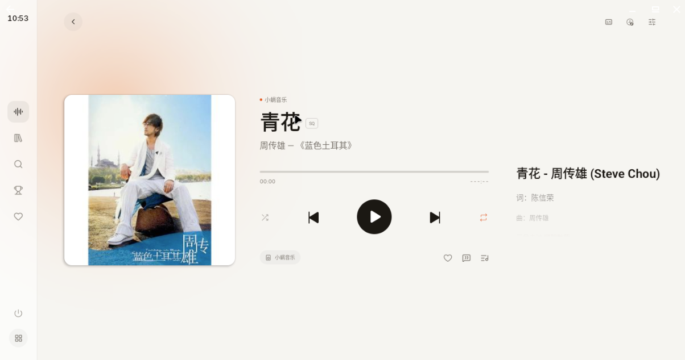
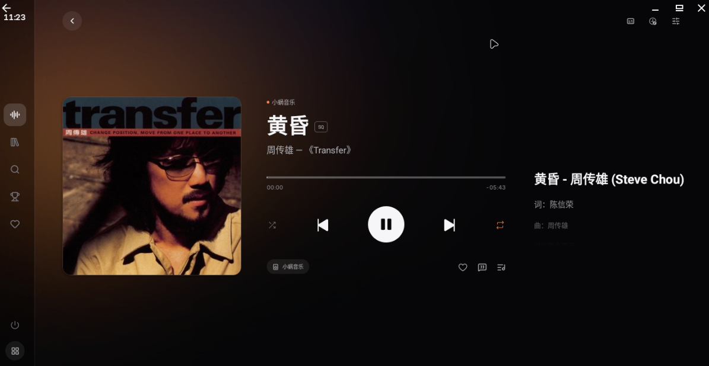

# LX Music Car

基于 [lx-music-mobile](https://github.com/lyswhut/lx-music-mobile) 二次修改的 Android 音乐播放器 UI，面向**车机与平板**，为横屏大屏重新设计布局与交互。

- 适配横屏的导航、音乐列表与播放界面，便于大屏触控。
- 提供白天、黑夜主题，适应不同光线环境。
- 保留原项目的音乐搜索、歌单管理、歌词等功能。

## 界面预览

### 白天主题

### 黑夜主题

## 本地运行

安装依赖并连接 Android 设备后，运行 `npm run android`；独立 APK 打包使用 `npm run pack:android:standalone`。离线语音构建还需要 Rust 和 Android 编译目标，见 [离线语音输入](docs/Android语音输入.md)。详见 [Android 启动与打包](docs/Android启动与打包.md)。

## 版本与更新

本项目从 **1.0.0** 开始独立编号，不跟随 LX Music Mobile 的版本号。
应用只检查 `package.json` 中 `repository.url` 对应仓库的 `master/publish/version.json`，
不会回退到原项目的 npm、Gitee 或其他更新源。更新元数据必须包含 `name: "lx-music-car"`，
缺少标识或标识不匹配的旧元数据会被拒绝。

发布时请同步维护 `package.json` 的 `version`、递增的 Android `versionCode`、
`package-lock.json` 的根版本，以及 `publish/version.json`、`publish/changeLog.md`。
更新元数据中的 `history` 只记录本项目版本；原项目历史保留在 `CHANGELOG.md` 中。
安装包沿用 `lx-music-car-v<版本号>-<ABI>.apk` 命名，发布到同一仓库的 `v<版本号>` Release。
更新检测读取的是远程文件，本地改动需合入 `master` 后才会在更新源生效。

## 致谢与协议

感谢 [LX Music Mobile](https://github.com/lyswhut/lx-music-mobile) 提供开源基础。本项目遵循 [Apache-2.0](LICENSE) 及[原项目补充协议](docs/使用协议.md)。请尊重音乐版权，支持正版。

**离线语音组件授权提示**：新增的第三方推理源码及模型不因本项目的 Apache-2.0 声明而获得授权。当前接入用于本地验证，对外分发前必须确认代码、模型的使用及分发许可，见 [第三方说明](third_party/offline-stt/NOTICE.md)。
